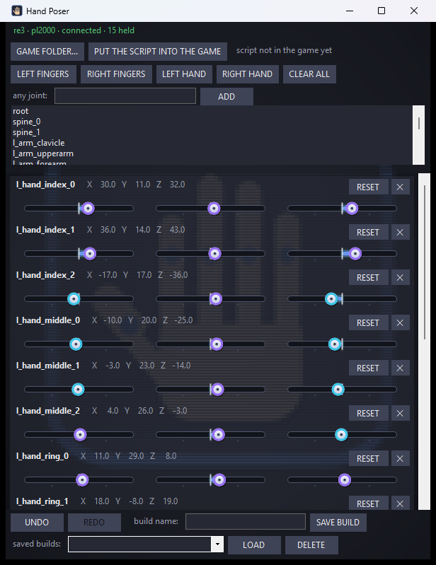

# Hand Poser — pose the player's hands in RE Engine games with sliders

> 🔧 **Still being worked on, while already in use.** Used with Visceral RE8 (Resident Evil Village VR) to pose the
> hands for each gun and reload spot; other RE Engine games have not been tried yet. Removing the script's file from the
> game's `reframework\autorun` folder undoes everything it does.

A small desktop window plus one REFramework script. Press **LEFT HAND** and the left wrist and every finger joint of the left hand get
a row with three sliders, X, Y and Z in degrees, already set to where the game has that finger right now. Move a slider
and the finger follows, live, and stays there while the game's own animation keeps running around it. Add any other
joint from the list (type part of its name to find it), take rows away with the cross, **RESET** one to zero. While you
drag a slider, the rows of the joints it carries along light up amber. **UNDO** and **REDO** go back and forth through
your last 200 changes. Every change is saved by itself and comes back next time; **SAVE BUILD** keeps a named pose to
**LOAD** later. Close the window and the game has its hands back.

Made for tuning hand and finger poses in our VR mods (2026-10-16): with Hand Freeze holding the controllers still and
Window View hanging this window inside the headset, fingers can be posed without taking the headset off. Inspired by
the poser inside alphaZomega's EMV Engine, which lives in REFramework's own menu; this one is a separate window so it
can be used that way.

## Get it

Download the zip from [Releases](https://github.com/TefMeister/hand-poser-vr/releases), unzip it, right-click
`install.ps1` and choose **Run with PowerShell**. A **Hand Poser** icon appears on the desktop; no administrator rights
are needed. Or build it yourself: `build.bat` (only the C# compiler that ships with Windows) then `install.ps1`.

The game needs [REFramework](https://github.com/praydog/REFramework) installed (the `dinput8.dll` in the game folder).

## Use

1. Start the game (RE2, RE3, or any other RE Engine game with REFramework; only RE2 and RE3 are the ones we run).
2. Double-click **Hand Poser**. The top line names the game it found; if it found none, press **GAME FOLDER...** and
   pick the game's install folder.
3. Press **PUT THE SCRIPT INTO THE GAME** once. It copies `hand_poser.lua` into the game's `reframework\autorun` folder.
   Restart the game, or open REFramework's menu (Insert) and press **Reset scripts**. The top line turns green:
   *re3 · pl2000 · connected*.
4. Load into the game so there is a character, then press **LEFT HAND** or **RIGHT HAND** (the wrist and all the
   finger joints; the arrow beside each jumps to a finger). ⚠️ A held wrist is turned the same way every frame, so the controller can no
   longer turn that hand (its row says so); remove the row (✕) to give the hand back to the controller. Or open **ANY JOINT ▼**, type part of a name, pick one from the list and press **ADD**.
5. With Visceral RE8 in Village, the **LEFT HAND, DOCKED** box follows where the left hand is docked on the gun (slide,
   magazine, pouch rounds, handle, a pair's landing spot) and moves and turns the wrist there, for that gun and spot only.
   It was the separate Dock Poser window until 2026-10-28.
5. Drag the sliders. X, Y and Z are the joint's local turning angles in degrees, −180 to 180; arrow keys nudge by half a
   degree, Page Up/Down by five.
6. Type a name next to **build name** and press **SAVE BUILD** to keep the pose; pick it under **saved builds** and press
   **LOAD** to get it back. The autosave needs no button.

Builds and the autosave live in `%APPDATA%\HandPoserVR\<game>\`, one folder per game.

## How it works

- **The window** (`app\`, C#) writes `command.json` into the game's `reframework\data\hand_poser\` folder on every change:
  which joints to hold, at what angles, and which joints it wants to read. It reads `state.json` from the same folder:
  the game name, the character, the whole skeleton (every joint and its parent) and the live angles of the joints it
  asked about. The parent links are what lights up the children while you drag.
- **The script** (`reframework\autorun\hand_poser.lua`) finds the player the way EMV Engine does (the game's
  `PlayerManager`, with RE4, RE7 and RE8 fallbacks), lists the joints of its transform, writes `state.json` about once a
  second, reads `command.json` every three frames, and writes each held joint's local Euler angle at
  `LateUpdateBehavior` and again at `PrepareRendering`, after the animation has run: the timing EMV's poser proved.
  Joints that are not held are never touched. Its own small section in REFramework's menu shows what it is holding and
  has a **Let go of everything** button.
- A freshly added joint is only *read* until the game has reported its angle; then it is held at that angle, so adding
  a finger never makes it jump.
- The sliders are drawn by the app itself (`app\Skin.cs`, 2026-10-25). The stock Windows slider paints itself white for a
  moment before its dark colours, and Window View photographs the window many times a second, so that moment showed as a
  random white flicker. The window's background is the app's own icon, finely pixelated and still
  (the scan lines and rolling light came off on 2026-10-25, to spare the headset: a still window costs Window View
  nothing while nobody touches it).
- Finger groups (2026-10-25, Tefa: *"one slider bends a whole finger and all its joints follow"*): joints whose names
  differ only in a trailing number (`L_IndexF1..3`, `l_hand_index_0..2`) get a **bend all** bar above the joints. Drag it
  and every joint of that finger turns by the same amount on the chosen axis (**axis X / Y / Z**, remembered per finger),
  their own sliders following live; let go and the bar springs back to 0, so it nudges as often as needed. UNDO takes a
  whole drag back.
- **From the hand** (2026-10-25, Tefa: *"can the other sliders that are affected also change their values in real time"*):
  a joint's own angles never change when a joint above it turns, so each row also shows the joint as turned from the hand,
  reported by the game several times a second while anything is held, which does change live.
- **One pose per gun** (2026-10-25, Tefa: "how do i save hand poses for guns individually?", then "yes please make it
  automatic!"): with **EACH GUN KEEPS ITS OWN POSE** ticked (on by default), the game script reports the gun in the right
  hand and every change is also saved as that gun's pose (`%APPDATA%\HandPoserVR\<game>\guns\<gun>.json`). Drawing
  another gun brings its own pose back; a gun never posed starts from the pose in hand. The status line says whose pose is
  shown. Named builds still work as before. Village reads the gun from the VR mode's `re8vr.weapon`.
- **Plain names** (2026-10-25, Tefa: *"R_IndexF1 is something that i don't know what it is until i try it"*): every row and
  finger bar says what the joint is ("Right index finger: knuckle (base)", "Left thumb: tip joint", "Left wrist (turns the
  whole hand)"), with the game's own name after it; the joint list shows them too, and its filter finds "index", "thumb" or
  "wrist". `app/JointNames.cs` knows Village's and RE2 / RE3's names and the body's.
- **Controller buttons** (2026-10-25, Tefa: *"add tick boxes to each customizable hand part ... X is -1, Y is -5 and holding LG
  makes X and Y repeat ... A and B and RG to do the same respectively for +"*): every slider and finger bar has a tick box.
  In Window View's controller mode (left stick click), **X** takes every ticked slider down 1 degree, **Y** down 5, **A**
  up 1, **B** up 5; a held **left grip** makes X and Y repeat at once and keep repeating, a held **right grip** the same
  for A and B. While anything is ticked, Window View leaves those buttons and the grips to the Hand Poser. One UNDO takes a
  whole press back. (`app/Nudge.cs` reads the buttons from Window View's shared block.)
- The icons of the four helper apps (Hand Poser, Grab Zones, Window View, Hand Freeze) share one tile, a dark rounded
  square with a blue edge; `tools/family_icons.py` draws all four.

## Tested

- `dist\HandPoser.exe --selftest <folder>`: 22 checks on the parts that need no game (skeleton reading, children,
  first angles from the game, holding, clamping, undo, redo, builds, autosave, the command file, a half-written state
  file). All pass (2026-10-16).
- `test\fake_game.py <folder>` pretends to be the script; `HandPoser.exe --game <folder>\FakeGame --demo` adds the left
  fingers and turns one. The fake game saw both commands, with the first angles taken from it (2026-10-16).
- In use with Visceral RE8 since 2026-10-18; not yet run in another game. The joint names the quick-add buttons look for (`l_hand_index_0` ... `r_hand_thumb_2`,
  `l_arm_wrist`, `r_arm_wrist`) are the ones RE2's player skeleton uses; other RE games may differ, and then the list
  under **ANY JOINT ▼** is the way in.

## Limits (for now)

- Holding is absolute: the held joint stays at the slider's angle whatever the animation wants. Blending with the
  animation, warning when fingers overlap, and nudging them apart automatically are later steps.
- Hands first: the quick-add buttons know the hands; everything else is added one joint at a time from the list.
- RE Engine games only, through REFramework. The window itself knows nothing about the game and could talk to another
  engine's script with the same two files.

## Credits

- **alphaZomega** — [EMV Engine](https://github.com/alphazolam/EMV-Engine), whose poser (freeze joints, pose by local
  Euler angles, undo, saved poses) this tool is modelled on. Nothing is copied; the timing and the approach are learned
  from it.
- **praydog** — [REFramework](https://github.com/praydog/REFramework), which runs the script.
- The screenshot was taken with a stand-in game.

If you should be credited here and are not, open an issue on this repository and it will be fixed.

## Licence

MIT for everything in this repository that we wrote. REFramework and EMV Engine are their authors' and are not included.
